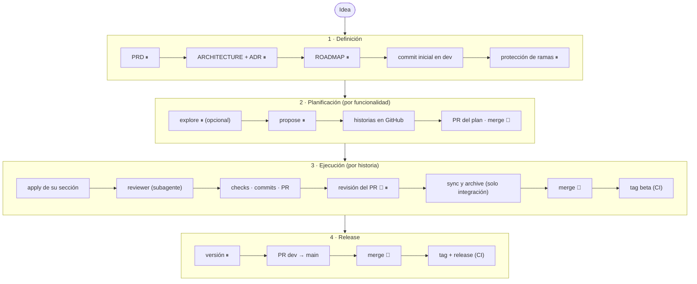

# WORKFLOW

Cómo se trabaja en este repositorio, desde la idea hasta producción: qué se hace en cada fase, quién lo hace y dónde se para. Vale para personas y agentes de IA. Los pasos detallados de cada fase están en su skill de [`.agents/skills/`](.agents/skills/). Convenciones: [`CONTRIBUTING.md`](CONTRIBUTING.md). Reglas de la IA: [`AGENTS.md`](AGENTS.md).

## 1. Visión general



⏸ parada para aprobación humana · 👤 acción humana · (CI) lo hace GitHub Actions al mergear. Entre paradas, la IA encadena los pasos sin esperar órdenes e informa al llegar.

**La unidad de especificación es la funcionalidad, no la historia.** Una funcionalidad es un bloque coherente de una épica que aporta valor por sí solo, y se especifica con un único cambio de OpenSpec: propuesta, delta de specs, diseño y tareas, agrupadas en una sección por historia. Primero se escribe la spec y después se crean las historias de GitHub a partir de esas secciones, no al revés. Cada historia se implementa en su propia rama y su propio PR, y el cambio se archiva en el PR de la última sección, la de integración. Una épica pequeña es una sola funcionalidad; una grande se reparte en varias, una detrás de otra.

**Quién decide.** La persona decide el producto, el alcance, los requisitos, el plan de cada funcionalidad y cómo se divide en historias, qué historia se hace, qué se mergea y qué se publica. La IA propone, ejecuta y comprueba: redacta, implementa, valida, mantiene la documentación y prepara commits y PRs.

## 2. Mapa de documentación

Cada dato tiene un único documento dueño; los demás lo enlazan en lugar de copiarlo. Si un dato aparece duplicado o contradictorio, prevalece su dueño.

| Documento | Fuente de verdad de |
|---|---|
| [`README.md`](README.md) | Presentación del proyecto, herramientas y puesta en marcha |
| [`WORKFLOW.md`](WORKFLOW.md) | Fases, paradas y mapa de documentación |
| [`CONTRIBUTING.md`](CONTRIBUTING.md) | Idioma, modelo de trabajo, Ready/Done, ramas, commits, Issues, PRs, CI y versiones |
| [`AGENTS.md`](AGENTS.md) | Índice para la IA: qué leer en cada tarea, principios, límites, OpenSpec y subagentes |
| [`.agents/skills/`](.agents/skills/) | Procedimientos de la IA, uno por tarea, y las skills de OpenSpec. Índice en [AGENTS §1](AGENTS.md#1-qué-leer-para-cada-tarea) |
| [`.agents/agents/`](.agents/agents/) | Instrucciones de los subagentes; `.opencode/`, `.codex/` y `.claude/` las adaptan a cada herramienta y fijan sus permisos |
| [`.github/rulesets/`](.github/rulesets/) | Protección de las ramas `dev` y `main` en GitHub |
| [`Makefile`](Makefile) | Comandos del proyecto (`make help`) |
| `compose*.yaml` y `.env.example` | Servicios y variables de cada entorno |
| [`docs/PRD.md`](docs/PRD.md) | Visión, objetivos (`OBJ`), alcance, requisitos (`RF`, `RNF`, `RD`), glosario y decisiones de producto (`DEC`) |
| [`docs/ARCHITECTURE.md`](docs/ARCHITECTURE.md) | Stack, componentes, datos, operación, calidad y despliegue (actual y objetivo) |
| [`docs/ADR/`](docs/ADR/README.md) | Razonamiento de las decisiones técnicas significativas |
| [`docs/CONTRACTS/`](docs/CONTRACTS/README.md) | Interfaces estables entre componentes y su versionado |
| [`docs/ROADMAP.md`](docs/ROADMAP.md) | Hitos, épicas, los cambios de OpenSpec de cada épica y las dependencias entre ellas |
| [`docs/ISSUE_LABELS.md`](docs/ISSUE_LABELS.md) | Nombre, uso y color de cada etiqueta |
| GitHub Issues | Épicas e historias: estado, jerarquía y bloqueos |
| `openspec/changes/` | El plan de cada funcionalidad en curso: propuesta, delta de specs, diseño y tareas agrupadas por historia (`tasks.md` es la fuente de verdad del avance) |
| `openspec/specs/` | Comportamiento implementado y verificado |

### Trazabilidad

```text
OBJ-n (PRD) → RF-n (PRD) → épica (ROADMAP + Issue) → funcionalidad (cambio de OpenSpec)
  → historia (Issue = sección de tasks.md) → PR → spec (openspec/specs/, al archivar el cambio)
```

Cada eslabón cita el ID del anterior.

### Qué actualizar cuando algo cambia

Al cerrar una historia solo se actualiza lo que el cambio afecta:

| Si el cambio… | Se actualiza |
|---|---|
| Añade o cambia comportamiento | Las specs, mediante `sync` y `archive` en el PR de la sección de integración |
| Cambia la intención de producto | El PRD, solo si figuraba en el plan aprobado |
| Cambia componentes, stack, datos, operación o despliegue | ARCHITECTURE |
| Toma una decisión técnica significativa | Un ADR nuevo y su índice (skill `adr`) |
| Cambia una interfaz entre componentes | El contrato y su versión (skill `contracts`) |
| Cambia cómo se arranca o se levanta algo | Los objetivos del `Makefile` y, si cambian los requisitos previos, ARCHITECTURE §7 |
| Muestra que el plan de la funcionalidad debe cambiar | El cambio de OpenSpec, con `update` y aprobación de la persona |
| Muestra que el plan del producto debe cambiar | El ROADMAP, solo con aprobación: se propone, no se aplica |

## 3. Herramientas

Las herramientas, su instalación y lo que lee cada herramienta de IA están en el [README](README.md#herramientas). La configuración de GitHub (rama por defecto, métodos de merge, etiquetas y protección de ramas) se aplica con objetivos del `Makefile` ([CONTRIBUTING §3](CONTRIBUTING.md#protección-de-ramas)). Las integraciones de las herramientas de IA (`.agents/`, `.opencode/`, `.codex/` y `.claude/`) se versionan, salvo los ajustes personales y las copias que excluye `.gitignore`.

## 4. Fase 1 — Definición

Skill `project-definition`. La idea se convierte en los documentos base, en este orden: PRD → ARCHITECTURE (+ADR) → ROADMAP. Cada uno se deriva del anterior ya aprobado.

1. Se trabaja directamente en `dev`, sin rama ni PR: es la única vez, antes de proteger las ramas.
2. Para cada documento, la IA hace solo las preguntas imprescindibles y redacta un borrador corto. Lo no confirmado va a «Preguntas abiertas». Los documentos crecen con el proyecto.
3. ⏸ La persona aprueba el documento y la IA pasa al siguiente.
4. Al aprobar el ROADMAP, la IA borra la carpeta `setup/`, hace el commit inicial de la definición en `dev` (`docs: add project definition`) y lo publica.
5. ⏸ Con la aprobación de la persona, la IA protege `dev` y `main` ([CONTRIBUTING §3](CONTRIBUTING.md#protección-de-ramas)). Desde aquí, todo entra por PR.

El ROADMAP llega hasta las épicas. Las funcionalidades y las historias no se deciden aquí, sino al planificar cada épica.

**Cambios posteriores.** Cuando cambia el producto (un requisito nuevo, otro alcance, un hito nuevo), se repite esta fase solo para los documentos afectados: rama `docs/` propia, la misma parada y un PR a `dev`.

## 5. Fase 2 — Planificación de una funcionalidad

Skill `feature-planning`. Se planifica una funcionalidad cada vez, normalmente la siguiente de la épica en curso; mientras se ejecutan sus historias se puede planificar la siguiente si no depende de ella. El ROADMAP se revisa al terminar cada hito.

1. **Preparar y explorar.** La IA crea la Issue de la épica si falta y, si la épica es nueva, propone cómo repartirla en funcionalidades. Si los requisitos o el enfoque no están claros, explora.

   ⏸ **Parada 1 — exploración** (solo si se exploró). La persona revisa las conclusiones y el reparto.

2. **Proponer.** La IA crea el cambio de OpenSpec de la funcionalidad: propuesta, delta de specs, diseño y `tasks.md`, con una sección por historia según el [trabajo por capas](#trabajo-por-capas).

   ⏸ **Parada 2 — plan.** La persona revisa los artefactos y la división en historias.

3. **Crear las historias y publicar el plan.** La IA crea una Issue por sección de `tasks.md`, con la jerarquía y los bloqueos nativos de GitHub, enlaza el cambio en el ROADMAP y abre el PR del plan a `dev`. 👤 La persona lo mergea con el CI en verde. Desde ese momento las historias se pueden empezar, mejor en una sesión nueva: el cambio guarda todo lo necesario.

### Trabajo por capas

Las épicas son capacidades de producto; las historias de cada funcionalidad, las secciones de su `tasks.md`, se dividen por capa para que frontend y backend avancen en paralelo.

- **Épicas:** capacidades de producto («generar una publicación desde un briefing»), no componentes («backend», «frontend»).
- **La primera épica es un *walking skeleton***: desde su primera historia, el producto está levantado y en producción aunque todavía no haga nada, para ir viendo la aplicación real desde el principio. Incluye:
  - la estructura de cada servicio, con un punto de salud (por ejemplo, `GET /health`) y un camino mínimo que los conecta (skill `add-service`);
  - el `Makefile` con todos los objetivos de [CONTRIBUTING §10](CONTRIBUTING.md#10-entorno-de-ejecución-makefile-docker-y-variables): instalación, arranque de todo o de cada servicio, con o sin Docker, y `make help`;
  - un `Dockerfile` por servicio, `compose.yaml`, `compose.override.yaml` y `compose.production.yaml`, y los `.env.example` de la raíz y de cada servicio;
  - el lint y los tests de cada servicio, que el CI ejecuta en Docker con `make ci`;
  - el despliegue: `dev` en el entorno de pruebas y `main` en producción ([ARCHITECTURE §9](docs/ARCHITECTURE.md#9-despliegue)).
- **Historias por capa:** cada sección toca una capa (`backend`, `frontend`…), cabe en un PR y deja su capa funcionando y probada.
- **Contrato primero:** si varias capas se comunican, la primera sección define el contrato en [`docs/CONTRACTS/`](docs/CONTRACTS/README.md) y bloquea a las de capa; estas avanzan en paralelo contra el contrato (el frontend, con mocks).
- **Integración:** la última sección de cada funcionalidad conecta las capas y comprueba el resultado de extremo a extremo. Depende de todas las demás, así que empieza cuando ya están en `dev`, y su PR es el que archiva el cambio.
- **El orden** prioriza lo que más riesgo reduce o antes valida las decisiones abiertas.

### Historias sueltas

Un bug o una mejora que no pertenece a ninguna épica en curso lleva su propio cambio pequeño, con las mismas paradas en una sola rama y un solo PR: `propose` ⏸, `apply`, reviewer, PR, revisión ⏸, `sync` y `archive`. Si la persona le pone la etiqueta `no-spec`, la Issue hace de plan y no hay cambio de OpenSpec.

## 6. Fase 3 — Ejecución de una historia

Skills `story` y `pull-requests`. Pueden estar en curso a la vez las historias sin bloqueos entre sí, cada una en su rama y su PR, con una persona o una sesión de IA por historia o con el subagente `implementer` ([AGENTS §5](AGENTS.md#5-subagentes)). Cada historia solo toca su sección de `tasks.md`.

1. **Implementar.** La IA comprueba la [definición de Ready](CONTRIBUTING.md#definición-de-ready), crea la rama y usa `apply` sobre la sección de la historia, con sus tests. Si el plan no se sostiene, se detiene y propone un `update` del cambio ⏸, que la persona aprueba antes de seguir.
2. **Revisar con el subagente.** El `reviewer` revisa con el contexto limpio y la IA corrige los hallazgos dentro del alcance hasta que no quede ninguno. Los de fuera del alcance los propone como Issue.
3. **Publicar, sin pausas.** Checks, documentación afectada, commits y PR a `dev` con `Closes #N`. La IA espera al CI y corrige lo que falle: nunca entrega un PR en rojo. Avisa con el enlace al PR, el resultado del reviewer y de los checks y la versión prevista que comenta el CI.
4. **Revisar.** 👤 La persona revisa el código una sola vez, en el PR de GitHub. La IA publica en el mismo PR las correcciones que pida, vuelve a pasar el reviewer y espera al CI.

   ⏸ **Parada 3 — PR revisado.** Revisión conforme, CI en verde y versión prevista aprobada.

5. **Archivar, solo en la sección de integración.** La IA hace `verify` del cambio completo, añade `sync` y `archive` como últimos commits y `Closes #E` si es la última funcionalidad de la épica, y espera al CI. Si falla, las correcciones entran en este mismo PR.
6. **Merge.** 👤 La persona hace el merge a `dev`. GitHub cierra la historia (y la épica) y el CI crea el tag beta si el cambio afecta a la versión ([CONTRIBUTING §9](CONTRIBUTING.md#9-versiones-y-releases)).

## 7. Fase 4 — Release

Skill `release`. Cuando la persona decide publicar una versión:

1. La IA propone la versión, que es la del último tag beta sin el sufijo, lista las historias incluidas y avisa si en `dev` hay funcionalidades a medias, que también llegarían a producción. Si no hay un tag beta posterior a la última versión estable, no hay versión nueva que publicar.
2. ⏸ La persona aprueba la versión.
3. La IA abre el PR `dev` → `main` con la versión y `Refs #N` de cada historia incluida.
4. 👤 La persona hace el merge a `main`.
5. El CI crea el tag `vX.Y.Z` y la GitHub Release, con notas generadas desde el último tag estable.

Las correcciones urgentes siguen el mismo camino ([CONTRIBUTING §7](CONTRIBUTING.md#correcciones-urgentes)).
