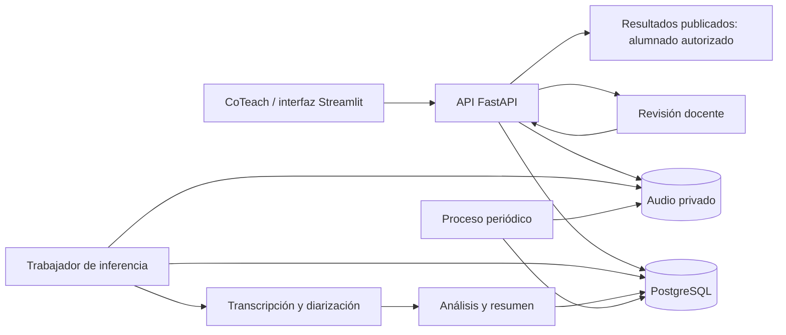

# ARCHITECTURE

> Propuesta pendiente de revisión. Todas las piezas nuevas son **Candidatas**, no implementadas ni aprobadas. El [PRD](PRD.md) conserva estado Borrador; esta propuesta responde al alcance RF-01 a RF-05 autorizado y no supone su aprobación completa.

Fuentes: [briefing](references/BRIEFING_COTEACH.md), [respuestas de Lay](references/RESPUESTAS_LAY.md) y [WORKFLOW](../WORKFLOW.md). Los requisitos pertenecen al PRD; las opciones técnicas y políticas operativas siguientes requieren consenso.

## 1. Visión general

Proponer un backend modular Python, con API y procesos de trabajo separados, compartiendo PostgreSQL y almacenamiento privado. Una interfaz Streamlit consume exclusivamente la API. Un único trabajador de inferencia procesa inicialmente una clase cada vez, por etapas, para limitar memoria. Un proceso ligero independiente publica resultados vencidos y elimina audios aunque la GPU esté ocupada.



RF-01 a RF-05 incluyen revisión y publicación. RF-06 (resumen individual grupal) y RF-07 (referencias temporales pedagógicas) quedan fuera del MVP. Las marcas temporales de la transcripción siguen siendo necesarias en RF-02.

## 2. Stack

| Área | Tecnología propuesta y compromiso | Estado | Decisión |
|---|---|---|---|
| API y dominio | Python 3.11, FastAPI, Pydantic 2; validación y OpenAPI, sin inferencia dentro de peticiones HTTP | Candidata | [ADR-0001](ADR/0001-modular-backend.md) |
| Persistencia | PostgreSQL 17, SQLAlchemy 2, Alembic; mismo motor en desarrollo y producción | Candidata | [ADR-0002](ADR/0002-durable-jobs.md) |
| Interfaz de demostración | Streamlit; rapidez de entrega, edición sencilla; autorización siempre en API | Candidata | ADR-0001 |
| Audio | FFmpeg para normalización; faster-whisper con Whisper small multilingüe como primera evaluación | Candidata | [ADR-0003](ADR/0003-private-inference.md) |
| Diarización | pyannote.audio con speaker-diarization-community-1; evaluar errores y acceso a pesos | Candidata | ADR-0003 |
| Análisis | Qwen3-8B cuantizado mediante llama.cpp, modo sin razonamiento extendido, salida JSON validada | Candidata | ADR-0003 |
| Operación | Docker Compose, volúmenes privados y proxy Caddy con TLS en servidor | Candidata | [ADR-0004](ADR/0004-access-and-retention.md) |
| Calidad | pytest, Ruff, HTTPX y pruebas de contrato; reloj controlable para publicación/purga | Candidata | ADR-0001 |

Las versiones menores, imágenes y revisiones de pesos se fijarán tras una prueba de compatibilidad, sin usar etiquetas flotantes en entrega. No se ha ejecutado ningún benchmark. No se garantiza calidad multilingüe ni capacidad con este tamaño de modelo.

## 3. Componentes

| Componente | Responsabilidad | Datos que posee | Depende de | Estado |
|---|---|---|---|---|
| api | Recepción, autorización por clase, validación, consulta, edición y aprobación | Clases, permisos, revisiones y resultados publicados | PostgreSQL, almacenamiento | Candidata |
| worker | Normalizar, transcribir, diarizar, combinar intervenciones, analizar | Artefactos por etapa y metadatos de ejecución | Cola PostgreSQL, audio, modelos | Candidata |
| maintenance | Publicar vencidos, recuperar trabajos abandonados, purgar audio | Vencimientos, auditoría de publicaciones y borrados | PostgreSQL, almacenamiento | Candidata |
| demo | Vistas docente/alumnado y seguimiento de trabajos | Solo estado de sesión; nunca copia autoritativa de resultados | API | Candidata |

API, worker y maintenance comparten paquete de dominio y migraciones; no son microservicios independientes. La IA se encapsula en adaptadores para sustituir modelos sin cambiar la API pública. Ningún modelo decide permisos ni ejecuta instrucciones contenidas en el audio.

Reparto propuesto entre tres personas, sin crear aún historias: persona A, API/persistencia/autorización/maintenance; B, inferencia y evaluación; C, interfaz/revisión y pruebas de extremo a extremo. A y C comparten la validación de RF-05. Primero acordar contratos y ejemplos sintéticos; B y C desarrollan contra ellos con dobles mientras A construye persistencia. La integración y revisión son responsabilidad conjunta. El reparto se formalizará en fase 2, con contrato primero e integración al final.

## 4. Estructura del repositorio

Actual: documentación, OpenSpec, Makefile, Compose de plantilla y workflows de CI. La propuesta no presupone servicios existentes.

Estructura candidata:

```text
backend/                 # Makefile, Dockerfile dev/prod, .env.example
  app/api/
  app/domain/
  app/inference/
  app/jobs/
  app/storage/
  migrations/
  tests/
demo/                    # Makefile, Dockerfile dev/prod, .env.example
  app/
  tests/
docs/CONTRACTS/           # contratos por aprobar en fase 2
docs/ADR/
openspec/
```

El mismo backend ofrece entradas para API, worker y maintenance. Modelos, audios y secretos se almacenan fuera del árbol versionado. Se conserva un único Makefile raíz y los tres archivos Compose existentes.

## 5. Flujos principales

### Recepción y procesamiento

1. API autentica al emisor y valida acceso a la clase, referencia del consentimiento, participantes y límites de tamaño/duración configurados. Formatos comprimidos exactos pendientes de muestras.
2. Escritura temporal con nombre opaco, validación de contenido y movimiento al almacenamiento privado. Transacción crea clase/audio/trabajo; responder 202 solo tras persistencia. Un limpiador elimina huérfanos de cargas fallidas.
3. Worker reclama un trabajo mediante transacción corta y lease; transcribe y diariza por separado y cruza intervalos temporales. No mantiene bloqueos de base de datos durante inferencia.
4. Los hablantes reciben identificadores de sesión. Los nombres aportados no identifican voces por sí solos: proponer asignación manual docente. Solapamientos o asignaciones ambiguas quedan señalados, nunca inventados.
5. El análisis procesa fragmentos limitados por tokens y consolida categorías y resumen general. Validar esquema y referencias internas; una categoría puede estar vacía. No generar calificaciones o diagnósticos no solicitados.
6. Persistir versión de resultados válida y pasar a revisión. Fallos de IA no producen resultados publicables.

Estados candidatos: queued → normalizing → transcribing → diarizing → analyzing → ready_for_review → published. failed y expired son salidas explícitas; retry_wait permite reanudar desde la última etapa válida. Estados de revisión separados: pending, in_review, approved.

### Revisión y publicación

Propuesta: contar el plazo desde ready_for_review, almacenar review_due_at en UTC y capturar el valor de configuración al crear la revisión. Las 24 horas son provisionales según PRD DEC-05, pendientes de Lay. Cambiar configuración afecta a nuevos resultados; no altera silenciosamente vencimientos existentes.

El docente edita con control de versión y aprueba; la API publica la versión aprobada. Maintenance publica solo resultados válidos con revisión pending y plazo vencido. Ambas rutas bloquean la misma fila y efectúan una transición atómica e idempotente. La API del alumno solo devuelve la versión publicada de su clase.

Pendiente de producto: qué hacer con una revisión iniciada pero no aprobada al vencer. Propuesta conservadora para consenso: mantener in_review sin publicación automática y avisar al docente. Tampoco se decide aquí la política de edición posterior a publicación. Publicar significa habilitar consulta; correo y notificaciones externas no se presuponen.

### Fallos y recuperación

Proponer máximo tres intentos con espera creciente para errores transitorios; errores de formato, permiso o consentimiento no se reintentan. Guardar etapa, código de error, intento, próximo intento y lease_token. Heartbeat renueva lease; al caducar se recupera el trabajo y se rechazan escrituras de un trabajador con token antiguo.

OOM reduce concurrencia y requiere diagnóstico; no se sustituye modelo silenciosamente. Resultados de etapa se guardan con versión y hash de entrada, para evitar repetir audio ya procesado. Idempotencia de carga por emisor y clave; misma clave con contenido diferente devuelve conflicto. Purga/cancelación invalida leases y resultados tardíos. Maintenance independiente permite cumplir vencimientos durante inferencias largas.

### Interfaces candidatas, aún no contratos aprobados

| Productor → consumidor | Interfaz propuesta | Contenido y reglas |
|---|---|---|
| CoTeach/demo → API | POST /v1/classes, multipart, Idempotency-Key | audio, external_class_id, participantes con id/rol/nombre opcional, consentimiento referenciado; respuesta 202 con class_id/job_id |
| API → demo/CoTeach | GET /v1/jobs/{id} | state, stage, attempt, error.code, retryable; autorizado por clase |
| API → docente/alumnado | GET /v1/classes/{id}/result | schema_version, result_version, transcript, analysis, publication; docente ve borrador, alumno solo publicado |
| Docente → API | PATCH /v1/classes/{id}/review; POST .../approve | cambios y versión esperada; conflicto 409 si cambió; roles contrastados con identidad autenticada |
| Worker → dominio | Resultado de etapa validado | job_id, lease_token, stage, model_revision, payload, warnings |

Esquema propuesto de transcript: segments con id, start_ms, end_ms, speaker_id, text; speakers con id y participant_id nullable. Analysis contiene general_summary y items con category/content; categorías del RF-03. Referencias internas a segmentos para evaluación no constituyen navegación temporal RF-07. Publication contiene status, published_at, mode y versión publicada. Fechas UTC ISO 8601; errores sin textos de audio ni secretos. Límites de duración, formato y tamaño deben acordarse antes de estabilizar recepción.

Estas tablas son diseño preliminar. La primera historia de contrato trasladará su definición normativa a OpenAPI/JSON Schema en [CONTRACTS](CONTRACTS/README.md), con ejemplos sintéticos, versionado y compatibilidad; después ARCHITECTURE enlazará allí sin duplicar campos. No se crean contratos ejecutables durante esta propuesta.

## 6. Datos, configuración y secretos

PostgreSQL independiente de la base de Odoo: classes, participants, class_access, audio_assets, jobs, result_versions, reviews, audit_events. Identidades externas referenciadas, sin duplicar gestión administrativa. Texto/JSON validado para resultados; índices relacionales para estados y vencimientos. Migraciones versionadas; originales de IA y correcciones docentes diferenciados.

Audio en volumen privado del servidor propio, con abstracción de almacenamiento para evolución; no en PostgreSQL ni en una carpeta servida por web. Cifrado de disco y transporte TLS; permisos mínimos por proceso. Capacidad inicial: diez clases × catorce días × tamaño medio medido, más espacio temporal y modelos. No se infiere tamaño del audio sin bitrate real.

La API exige identidad verificada y pertenencia a clase, también al consultar jobs y descargar audio. Proponer tokens firmados de vida corta con issuer/audience/expiry validados y permisos resueltos en servidor. El contrato del emisor de CoTeach sigue pendiente: no asumir que sus tokens de videollamada sirven. Demo con identidades sintéticas y tokens individuales emitidos por un emisor de pruebas aislado; nunca un selector de rol como autorización. Revisiones solo por docentes asignados. El alumno no obtiene borradores ni acceso a otra clase.

Consentimiento: registrar referencia, finalidad, fecha y responsable de la evidencia aportada por CoTeach; no confundir subir un audio con consentir. Validar con Lay autorización de las tres grabaciones, uso en demo y política antes de datos reales. No usar menores. Audios externos requieren permiso o licencia adecuados; estar publicados no basta.

Retención del original según RNF-02: 14 días desde recepción, guardando expires_at. Bloquear lectura y nuevas tareas al vencer; barrido periódico candidato de un minuto elimina original, normalizados, temporales y copias de inferencia. Registrar deleted_at; reintentar y alertar fallos físicos. La cadencia y tolerancia de borrado deben validarse para no prometer precisión imposible durante una caída. Al reiniciar, purgar vencidos antes de retomar trabajos. No incluir audio en backups del MVP; verificar que snapshots del host tampoco lo retienen. Una restauración reaplica vencimientos antes de servir datos.

Proponer borrar temporales de inferencia al finalizar cada trabajo. Retención de transcripciones, revisiones, auditoría y backups pendiente de Lay: no adoptar conservación indefinida por defecto ni introducir un plazo ficticio. Backups cifrados de base de datos y prueba de restauración con política de borrado acordada.

Configuración candidata: REVIEW_WINDOW_HOURS (24 provisional), límites de carga, MAX_ATTEMPTS, rutas/modelos/revisiones, dispositivos y concurrencia. Credenciales DB, firma y descarga de modelos solo en servidor mediante secretos; ejemplos inocuos versionados. Logs excluyen audio, nombres, transcripciones, tokens y prompts.

Sin APIs públicas de inferencia por defecto. Descarga de pesos separada de ejecución; revisar licencias, atribución y telemetría de dependencias. GPU remota privada recibe solo lo imprescindible; transferencia, ubicación, acceso del operador, retención y borrado necesitan aprobación y comprobación. Alquiler privado no elimina por sí solo exposición a terceros.

## 7. Entorno local y operación

Windows 11 + Git Bash permanece válido para Make, CLI, API e interfaz. Python 3.11 y FFmpeg para ejecución nativa; PostgreSQL en Docker o instalación equivalente. Dependencias GPU requieren drivers y versiones compatibles de CUDA/cuDNN/PyTorch/CTranslate2, a probar y fijar conjuntamente.

Advertencia técnica concreta: [Docker Desktop ofrece GPU en Windows mediante backend WSL2](https://docs.docker.com/desktop/features/gpu/). Esto no obliga a mover el checkout ni usar una terminal WSL, pero sí requiere ese backend para GPU en contenedores. Si se evita WSL2 totalmente, evaluar worker GPU nativo Windows o servidor Linux privado; CPU permanece como alternativa de pruebas. No se ha verificado compatibilidad del equipo real.

Puertos candidatos: API 8000, demo 8501, PostgreSQL 5432 solo en localhost/red privada; producción expone únicamente TLS por proxy. Los comandos serán objetivos Makefile según CONTRIBUTING; no se añaden en esta fase.

| Modalidad | Ventajas | Límites y costes | Uso propuesto |
|---|---|---|---|
| CPU local | Sin alquiler; control de datos | Latencia alta, carga prolongada y consumo a medir | Desarrollo y audios cortos |
| GPU local | Evita transferencias; coste marginal eléctrico | Disponibilidad compartida, VRAM y drivers desconocidos | Primera evaluación preferida |
| GPU privada remota | Capacidad reservable, equipo reproducible | Alquiler, almacenamiento, transferencias, operación y exposición al operador | Solo si el equipo local no alcanza la demostración y se aprueba presupuesto |
| API comercial de inferencia | Menor operación | Transferencias y dependencia; condiciones de privacidad/licencia por validar | No recomendada como base del MVP |

Hipótesis de dimensionamiento, no mínimos comprobados: host de 32 GB RAM y GPU de 12–16 GB VRAM para ensayar modelos secuenciales cuantizados, sin mantener ASR, diarizador y LLM simultáneamente. CPU de 16 GB puede servir para pruebas reducidas, sujeta a medición. Antes de reservar recursos medir con clases de 30 y 60 minutos, individuales y grupales.

Medir segundos de cómputo por minuto de audio, pico RAM/VRAM, tamaño de artefactos y energía si se dispone de contador. Coste diario estimado = horas GPU × tarifa + almacenamiento + transferencia; no hay presupuesto ni tarifa aprobados. Escoger el modelo más pequeño que alcance calidad acordada, cachear pesos y apagar GPU remota ociosa. Diez clases/día equivalen a 5–10 horas de audio; dimensionar desde esa carga y concurrencia real, no desde benchmarks publicados.

## 8. Calidad: tests, CI y observabilidad

- Unitarias: permisos, estados, validación, asignación manual de hablantes, edición y vencimientos con reloj controlado.
- Integración sobre PostgreSQL real: leases y recuperación, idempotencia, carreras aprobación/publicación, errores de almacenamiento, purga incluso con trabajos activos y reinicio tras vencimiento.
- Contratos: API y adaptadores con payloads sintéticos; respuestas malformadas de IA se rechazan. Tratar texto transcrito como datos, con pruebas de instrucciones maliciosas dentro del audio.
- E2E: docente carga audio, consulta progreso, corrige y aprueba; alumno autorizado ve publicado; otro alumno no accede. Ruta sin revisión publica al vencer el reloj simulado. Ruta in_review pendiente de decisión no se da por validada.
- Evaluación IA separada del CI habitual: corpus autorizado y simulado, sin audio real en repositorio ni artefactos públicos. Cubrir silencio, ruido, solapamientos, nombres, idiomas y cambios de idioma. Anotar transcripción/hablantes de referencia y contenidos pedagógicos esperados con Lay.
- Medir WER/CER según idioma, DER para diarización, atribución de hablante y revisión humana de errores, omisiones y afirmaciones inventadas. Umbrales y lenguas de aceptación pendientes; un JSON válido no prueba calidad pedagógica.
- CI existente conserva Convenciones/OpenSpec/Servicios. Los futuros servicios aportan lint/tests y construcción Docker a make ci; CI CPU usa dobles, evaluación GPU privada es una validación adicional antes de demo.
- Logs estructurados por job_id, etapa y error; métricas de cola, latencia por etapa, reintentos, memoria, vencimientos pendientes y fallos de purga. Health y readiness distinguen API viva de DB/modelos disponibles.

## 9. Despliegue

| Entorno | Rama | Cuándo se despliega (propuesta) | Estado |
|---|---|---|---|
| Pruebas | dev | Tras integración con CI verde, despliegue manual documentado inicialmente | Candidata |
| Producción | main | Tras promoción aprobada, despliegue manual de la versión publicada | Candidata |

Ambos entornos deben existir desde el walking skeleton según WORKFLOW; usar datos sintéticos hasta resolver consentimiento y acceso. Compose por entorno, bases/volúmenes/secretos separados. Servidor y dominios pendientes de acuerdo; no asumir GPU en el servidor actual de Odoo. Inferencia inicialmente junto al almacenamiento; mover worker a GPU privada solo con conectividad privada y limpieza de copias definida. Sin Kubernetes, broker adicional, vector DB ni entrenamiento propio para diciembre.

Guardar imágenes y migraciones compatibles; respaldar DB antes de migrar y ensayar restauración. CoTeach recibirá instrucciones de operación, purga, recuperación y actualización de modelos con evaluación previa.

## 10. Decisiones y contratos

Los [ADR](ADR/README.md) están en estado Propuesto. No hay contratos estables nuevos ni implementación. La propuesta necesita resolver:

1. Equipo: aceptar stack, reparto, licencias de código/pesos y acceso al diarizador; inventario real de RAM/GPU y una medición con audio autorizado.
2. Lay/equipo: idiomas y calidad mínima, formatos/límites de carga, presupuesto, alojamiento y disponibilidad durante las demostraciones.
3. Lay: validar 24 horas, comienzo del cómputo, revisión iniciada sin aprobación y correcciones tras publicación. Estas propuestas operativas no son requisitos confirmados.
4. CoTeach: emisor de identidad, autorización por clase y consentimiento; conservación de derivados y backups.
5. Aprobación del PRD y de esta arquitectura antes de cerrar ROADMAP y planificar las funcionalidades según WORKFLOW.

Fuentes técnicas consultadas: [faster-whisper](https://github.com/SYSTRAN/faster-whisper), [pyannote Community-1](https://huggingface.co/pyannote/speaker-diarization-community-1), [Qwen3-8B](https://huggingface.co/Qwen/Qwen3-8B), [llama.cpp](https://github.com/ggml-org/llama.cpp), [FastAPI y trabajos pesados](https://fastapi.tiangolo.com/tutorial/background-tasks/), [PostgreSQL SELECT y SKIP LOCKED](https://www.postgresql.org/docs/current/sql-select.html). Capacidades upstream no equivalen a pruebas realizadas en CoTeach.
